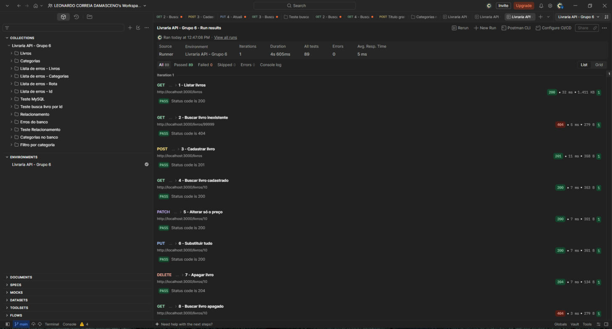
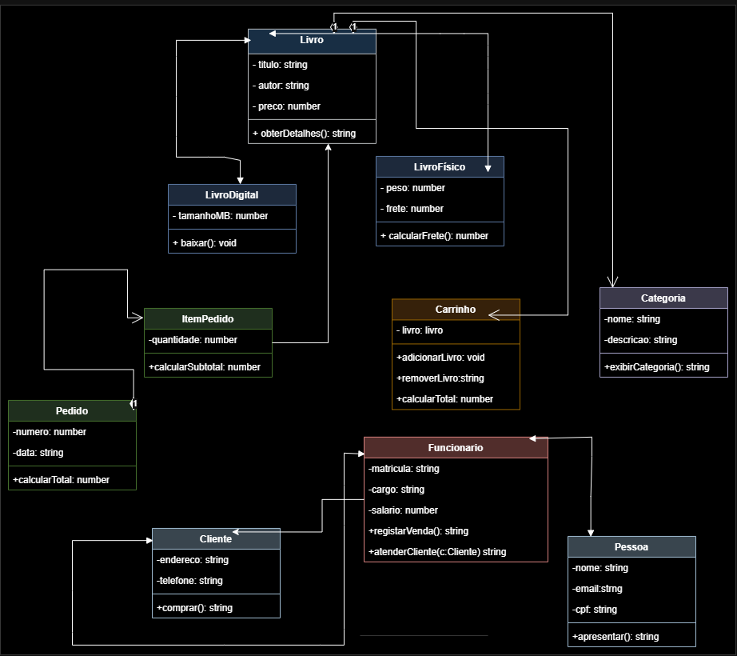

# 📚 API de Gestão da Livraria — Grupo Nº6

API REST para gerenciar o acervo de uma livraria: **livros** e **categorias**, guardados num banco **MySQL** e ligados por chave estrangeira.

Projeto da UC de Programação Back-End — Curso Técnico em Desenvolvimento de Sistemas
Escola SENAI "Santo Paschoal Crepaldi" — Turma 1-2026-SESI_DEV_OC_1

---

## 👥 Integrantes

* João Lucas de Abreu — [@abreu010](https://github.com/abreu010)
* Ana Vitória Napoli Sigole — [@anasigole-jpg](https://github.com/anasigole-jpg)
* Maria Eduarda Pereira dos Santos — [@mariaesantos54-png](https://github.com/mariaesantos54-png)
* Leonardo Correia Damasceno — [@leonardodamascenodev](https://github.com/leonardodamascenodev)

---

## 🛠️ Tecnologias

| Tecnologia | Para que serve no projeto |
|---|---|
| **Node.js** | Executa o JavaScript no servidor |
| **Express 5** | Cria as rotas e os middlewares da API |
| **MySQL** + **mysql2** | Banco de dados e a biblioteca que conversa com ele |
| **dotenv** | Lê os dados de acesso ao banco do arquivo `.env` |
| **nodemon** | Reinicia o servidor sozinho a cada alteração |
| **Postman** | Coleção de testes automáticos da API |

---

## 🚀 Como rodar o projeto

**1. Clonar e instalar as dependências**

```bash
git clone https://github.com/leonardodamascenodev/livraria-api-grupo6.git
cd livraria-api-grupo6
npm install
```

**2. Criar o banco**

Abram o `src/database/livraria.sql` no **MySQL Workbench** e rodem o arquivo inteiro (raio ⚡).
Ele apaga e recria o banco `livraria` com dados de exemplo — pode rodar de novo sempre que quiserem começar do zero.

**3. Configurar o `.env`**

Copiem o `.env.example` para um arquivo chamado `.env` e coloquem a senha do MySQL de vocês:

```env
DB_HOST=localhost
DB_PORT=3306
DB_USER=root
DB_PASSWORD=
DB_NAME=livraria
```

> ⚠️ O `.env` **não vai para o GitHub** (está no `.gitignore`). Cada integrante tem o seu.

**4. Ligar o servidor**

```bash
npm run dev
```

A API sobe em **http://localhost:3000**. No terminal deve aparecer `Conectado ao MySQL!`.

---

## 🗄️ Banco de dados

Duas tabelas, ligadas por **chave estrangeira**: cada livro aponta para a sua categoria.

```text
┌──────────────────────────┐          ┌──────────────────────────┐
│        categorias        │          │          livros          │
├──────────────────────────┤          ├──────────────────────────┤
│ id          INT  PK      │◄─────┐   │ id           INT  PK     │
│ nome        VARCHAR(50)  │      │   │ titulo       VARCHAR(150)│
│ descricao   VARCHAR(200) │      │   │ autor        VARCHAR(100)│
└──────────────────────────┘      │   │ preco        DECIMAL(10,2)│
                                  │   │ estoque      INT         │
                                  └───│ categoria_id INT  FK     │
                                      └──────────────────────────┘
       1 categoria  ───────────────────  0..* livros
```

**Dados de exemplo** criados pelo script:

| id | Livro | Categoria |
|:---:|---|---|
| 1 | Clean Code | Tecnologia |
| 2 | Eloquent JavaScript | Tecnologia |
| 3 | O Hobbit | Ficção |
| 4 | Entendendo Algoritmos | Tecnologia |
| 5 | Harry Potter e a Pedra Filosofal | Ficção |
| 6 | O Pequeno Príncipe | Infantil |
| 7 | O Menino Maluquinho | Infantil |
| 8 | Sapiens | História |
| 9 | O Diário de Anne Frank | História |

Categorias: **1 Ficção**, **2 Tecnologia**, **3 Infantil**, **4 História**. Todo livro da carga tem categoria.

**O banco protege a ligação:**
* não deixa um livro apontar para uma categoria que não existe;
* não deixa apagar uma categoria que ainda tem livros.

---

## 🔌 Rotas da API

### 📖 Livros — `/livros`

| Método | Rota | O que faz | Sucesso |
|---|---|---|:---:|
| `GET` | `/livros` | Lista os livros (aceita filtros) | 200 |
| `GET` | `/livros/:id` | Busca um livro pelo id | 200 |
| `POST` | `/livros` | Cadastra um livro | 201 |
| `PUT` | `/livros/:id` | Substitui **todos** os dados do livro | 200 |
| `PATCH` | `/livros/:id` | Altera só os campos enviados | 200 |
| `DELETE` | `/livros/:id` | Apaga o livro | 204 |

**Filtros do `GET /livros`** (podem ser combinados):

| Filtro | Exemplo | Retorna |
|---|---|---|
| `titulo` | `/livros?titulo=code` | Títulos que contêm o texto |
| `autor` | `/livros?autor=tolkien` | Autores que contêm o texto |
| `precoMin` | `/livros?precoMin=40` | Preço maior ou igual |
| `precoMax` | `/livros?precoMax=50` | Preço menor ou igual |
| `categoria` | `/livros?categoria=fic` | Livros cuja categoria contém o texto (os sem categoria ficam de fora) |

**Exemplo de corpo (`POST` / `PUT`):**

```json
{
  "titulo": "A Revolução dos Bichos",
  "autor": "George Orwell",
  "preco": 29.9,
  "estoque": 5,
  "categoria_id": 1
}
```

**Exemplo de resposta** — o livro já vem com o **nome** da categoria (via `LEFT JOIN`):

```json
{
  "id": 3,
  "titulo": "O Hobbit",
  "autor": "J.R.R. Tolkien",
  "preco": 39.9,
  "estoque": 8,
  "categoria_id": 1,
  "categoria": "Ficção"
}
```

> ℹ️ O `categoria_id` é opcional. Um livro sem categoria volta com `"categoria": null`.
> O `PUT` troca **tudo**: um `PUT` sem `categoria_id` deixa o livro sem categoria. Para mudar só um campo, usem o `PATCH`.

### 🏷️ Categorias — `/categorias`

| Método | Rota | O que faz | Sucesso |
|---|---|---|:---:|
| `GET` | `/categorias` | Lista as categorias (filtro `?nome=`) | 200 |
| `GET` | `/categorias/:id` | Busca uma categoria pelo id | 200 |
| `POST` | `/categorias` | Cadastra uma categoria | 201 |
| `PUT` | `/categorias/:id` | Substitui todos os dados | 200 |
| `PATCH` | `/categorias/:id` | Altera só os campos enviados | 200 |
| `DELETE` | `/categorias/:id` | Apaga a categoria (só se não tiver livros) | 204 |

**Exemplo de corpo:**

```json
{
  "nome": "Infantil",
  "descricao": "Livros para criancas"
}
```

### Outras rotas

| Rota | Resposta |
|---|---|
| `GET /` | 200, mensagem de boas-vindas |
| `GET /sobre` | 200, informações sobre a livraria |
| Qualquer outra | 404 `{ "erro": "Rota nao encontrada" }` |

---

## ✅ Validações

**Livro**

| Regra | Onde |
|---|---|
| `titulo`, `autor`, `preco` e `estoque` são obrigatórios no `POST` e no `PUT` | controller / middleware |
| `titulo` com no máximo 50 caracteres | middleware `validarLivros` |
| `preco` é número, entre 0 e 9999 | middleware `validarLivros` |
| `estoque` é inteiro e não negativo | controller |
| `categoria_id`, quando enviado, é número | controller |
| `id` da URL é número | middleware `validarId` |
| `GET` não pode ter corpo | middleware `validarLivros` |

**Categoria**

| Regra |
|---|
| `nome` é obrigatório no `POST` e no `PUT` |
| `nome` com pelo menos 3 letras |

---

## 🚦 Códigos de resposta e tratamento de erros

Os erros do banco passam pelo middleware `src/middlewares/tratarErros.js`, que mostra o código do erro no terminal e devolve uma resposta clara para o cliente.

| Status | Quando acontece |
|:---:|---|
| **200** | Deu certo e há dados na resposta |
| **201** | Registro criado |
| **204** | Registro apagado (sem corpo) |
| **400** | Dado inválido: campo faltando, tipo errado, valor grande demais ou **categoria que não existe** |
| **404** | Livro, categoria ou rota não encontrados |
| **409** | **Conflito**: tentar apagar uma categoria que ainda tem livros |
| **500** | Erro inesperado no servidor |
| **503** | Banco de dados desligado ou inacessível |

| Código do MySQL (terminal) | Significado | Status |
|---|---|:---:|
| `ER_NO_REFERENCED_ROW_2` | Apontou para uma categoria que não existe | 400 |
| `ER_ROW_IS_REFERENCED_2` | Tentou apagar uma categoria que tem livros | 409 |
| `ER_DATA_TOO_LONG` / `ER_WARN_DATA_OUT_OF_RANGE` | Valor grande demais para a coluna | 400 |
| `ECONNREFUSED` | MySQL desligado | 503 |

---

## 🧪 Testes no Postman

A coleção fica em `postman/collections/Livraria API - Grupo 6/`, com o environment em `postman/environments/`.

**Antes de rodar:** liguem o servidor, selecionem o environment **Livraria API - Grupo 6** com `baseUrl = http://localhost:3000` e rodem o `livraria.sql` para o banco começar limpo.

| Pasta | O que testa |
|---|---|
| **Livros** | CRUD completo de livros |
| **Categorias** | CRUD completo de categorias |
| **Teste MySQL** | CRUD e filtros de livros com os dados vindo do banco |
| **Teste busca livro por id** | Busca por id existente, inexistente e com letras |
| **Categorias no banco** | Categorias persistidas no MySQL |
| **Lista de erros - Livros** | Validações de livro (400) |
| **Lista de erros - Categorias** | Validações de categoria (400) |
| **Lista de erros - Id** | Id inválido na URL |
| **Lista de erros - Rota** | Rota inexistente (404) |
| **Erros do banco** | Título e preço grandes demais para o banco |
| **Relacionamento** | Livro com o nome da categoria, categoria inexistente (400) e apagar categoria com livros (409) |
| **Teste Relacionamento** | Fluxo completo do relacionamento livro × categoria, com limpeza no fim (pode rodar várias vezes) |
| **Filtro por categoria** | `GET /livros?categoria=` com `fic`, `TEC` e `fic` + `autor=tolkien` |

### 📸 Comprovação — Entrega do Bloco 4

Runner do Postman com a coleção inteira (71 requisições), o banco recém-criado pelo `livraria.sql` e a API ligada: **89 testes, 89 passaram, 0 falharam, 0 erros**.



O print fica em [`postman/entrega-bloco4.png`](postman/entrega-bloco4.png).

---

## 📁 Estrutura de pastas

```text
livraria-api-grupo6/
├── docs/
│   └── esquemauml.png            # Diagrama UML
├── postman/                      # Coleção e environment do Postman
├── src/
│   ├── config/
│   │   └── db.js                 # Conexão com o MySQL (pool)
│   ├── controllers/              # Recebem a requisição e devolvem a resposta
│   │   ├── livroController.js
│   │   └── categoriaController.js
│   ├── database/
│   │   └── livraria.sql          # Script que cria o banco e os dados de exemplo
│   ├── middlewares/
│   │   ├── logger.js             # Mostra cada requisição no terminal
│   │   ├── tratarErros.js        # Transforma erros do banco em respostas HTTP
│   │   ├── validarId.js          # Confere se o id da URL é número
│   │   └── validarLivros.js      # Validações de entrada de livros
│   ├── models/                   # Classes do diagrama UML
│   │   ├── Livro.js, LivroFisico.js, LivroDigital.js
│   │   ├── Categoria.js
│   │   ├── Pessoa.js, Cliente.js, Funcionario.js
│   │   └── Carrinho.js
│   ├── routes/                   # Ligam cada URL ao controller
│   │   ├── index.js
│   │   ├── livroRoutes.js
│   │   └── categoriaRoutes.js
│   ├── services/                 # Regras de negócio e SQL
│   │   ├── livroService.js
│   │   └── categoriaService.js
│   └── index.js                  # Ponto de entrada do servidor
├── .env.example                  # Modelo do .env
├── package.json
└── README.md
```

**Caminho de uma requisição:**

```text
Cliente ─► index.js ─► logger ─► routes ─► middlewares de validação ─► controller ─► service ─► MySQL
                                                                            │
                                         tratarErros ◄── erro do banco ─────┘
```

---

## 📐 Diagrama UML



* Contém todas as classes do modelo com atributos, métodos, multiplicidades e os 4 tipos de relacionamento (associação, agregação, composição e herança).
* As classes `Pedido` e `ItemPedido` constam apenas no diagrama, como planejamento; serão implementadas futuramente.

### Auditoria: UML × código

| Classe do diagrama | Em `src/models/` | No banco / API |
|---|:---:|:---:|
| Livro | ✅ | ✅ |
| Categoria | ✅ | ✅ |
| LivroFisico | ✅ | — |
| LivroDigital | ✅ | — |
| Pessoa | ✅ | — |
| Cliente | ✅ | — |
| Funcionario | ✅ | — |
| Carrinho | ✅ | — |
| Pedido | — | — |
| ItemPedido | — | — |

---

## 🗓️ Evolução do projeto

| Bloco | O que foi feito |
|---|---|
| **Bloco 1** | Modelagem UML: atributos, métodos, os 4 relacionamentos e multiplicidades |
| **Bloco 2** | Arquitetura MVC (routes, controllers, services) e auditoria UML × código |
| **Bloco 3** | Refatoração Clean Code, CRUD de livros e categorias em memória, validações e middlewares |
| **Bloco 4** | Integração com MySQL: livros e categorias no banco, tratamento de erros do banco (400/409/503), relacionamento livro × categoria com chave estrangeira e `JOIN`, testes automáticos no Postman |

*A divisão de responsabilidades é feita em rodízio entre os integrantes a cada bloco.*
